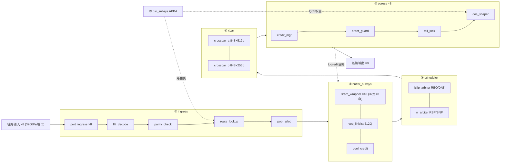

# CHI Router 架构规格文档

> 版本 v1.0（可交付 RTL 开发）｜频率 500 MHz｜VOQ 索引按 A-1=A2 定稿，其余 4 项按推荐基线锁定并显式标注

---

## 1. 文档信息

| 项 | 内容 |
|----|------|
| 文档名 | CHI Router Architecture Specification |
| 版本 | v1.0 |
| 状态 | 可交付 RTL 开发（含 4 项基线待复核项） |
| 目标协议 | CHI-BE（REQ/RSP/DAT/SNP） |
| 语言 | SystemVerilog-2017 |
| 交付物 | 本文档 + `rtl/` 骨架 + `tb/` + `syn/` + `sim/` |

### 1.1 变更记录

| 版本 | 说明 |
|------|------|
| v0.1 | 骨架 |
| v1.0 | 冻结 500 MHz、VOQ 索引 A2、接口/寄存器/约束全量定义 |

---

## 2. 需求与约束

### 2.1 功能需求

| ID | 需求 | 实现模块 |
|----|------|----------|
| F-01 | 8 双向端口 × 4 通道全双工 | port_ingress / port_egress |
| F-02 | CHI-BE Opcode 子集解析转发 | flit_decode |
| F-03 | NodeID→端口查表，CSR 可配，非法丢弃 | route_lookup / route_table |
| F-04 | per-flit parity 校验 + 错误上报/中断 | parity_check / err_regs |
| F-05 | VOQ：512 队列（每输入 64），统一池化缓冲 | buffer_subsys |
| F-06 | 三层保序（PoS 域 / packet 尾锁 / SN 序） | order_guard / tail_lock |
| F-07 | WRR + token bucket QoS 整形 | qos_shaper |
| F-08 | APB4 CSR + PMU 计数 | csr_subsys |

### 2.2 性能约束

| 项 | 值 | 公式 |
|----|-----|------|
| core 频率 | 500 MHz（T=2 ns） | — |
| APB 频率 | 100 MHz | — |
| 宽通道位宽 | 512 b | — |
| 窄通道位宽 | 256 b | — |
| 单链路峰值带宽 | 256 Gb/s = 32 GB/s | `W × f = 512 × 500M` |
| 聚合带宽（8 端口） | 2048 Gb/s = 256 GB/s | `8 × 32 GB/s` |
| 首字时延 | 9 cycle（18 ns） | 见 §3.5 |
| 缓冲容量 | 256 flit/端口 ≈ 16 KB | `32 bank × 512b × 64 深 / 8 端口` |
| 工艺 | 16/12 nm | — |

### 2.3 设计约束

| ID | 约束 |
|----|------|
| C-01 | SystemVerilog-2017，2 空格缩进，低有效异步复位 `rst_n`，无 latch，无 `initial`（TB 除外） |
| C-02 | 数据面单时钟域 `clk`（子域门控），配置面 `pclk` 独立 |
| C-03 | 所有跨模块接口 valid/ready 反压；组合路径不得跨两级以上 |
| C-04 | 编译顺序由 `rtl/filelist.f` 决定：pkg → common → buffer → ingress → sched → xbar → egress → csr → top |
| C-05 | 每通道至少保留 1 个不可被占用的 credit cell（死锁避免） |
| C-06 | 总线跨时钟域一律用握手同步，`sync_2ff` 仅用于单 bit |

---

## 3. 架构 Spec

### 3.1 模块划分

| 子系统 | 顶层模块 | 子模块 | 职责 |
|--------|----------|--------|------|
| ① ingress | `port_ingress` ×8 | flit_decode / parity_check / route_lookup / pool_alloc | 解析、校验、路由、分配入队 |
| ② buffer | `buffer_subsys` | sram_wrapper / voq_linklist / pool_credit | 统一池化 VOQ 存储 + credit |
| ③ sched | `scheduler` | islip_arbiter / rr_arbiter | 匹配仲裁 + 读请求生成 |
| ④ xbar | `crossbar_a` / `crossbar_b` | — | 宽/窄双平面选通 |
| ⑤ egress | `port_egress` ×8 | credit_mgr / order_guard / tail_lock / qos_shaper | credit 记账、保序、尾锁、QoS |
| ⑥ csr | `csr_subsys` | apb_slave / route_table / qos_regs / pmu_counters / err_regs | 配置 / PMU / 中断 |

### 3.2 架构拓扑



### 3.3 VOQ 索引定义（A-1 = A2 定稿）

```
qid[5:0] = {out_port[2:0], ch_grp[1:0], qos[1:0]}
```

| 字段 | 位宽 | 取值 | 说明 |
|------|------|------|------|
| `out_port` | 3 | 0~7 | 目标输出端口 |
| `ch_grp` | 2 | 0=REQ, 1=DAT, 2=RSP+SNP, 3=保留 | 窄通道合并 |
| `qos` | 2 | 0~3 | 4 级 QoS |

- 每输入 64 队列，8 输入共 **512 队列**
- 队列深度均值 = 256 flit / 64 = **4 flit/队列**

| 约束 | 内容 |
|------|------|
| C-1 | `ch_grp=2` 内部由 `rr_arbiter` 区分 RSP/SNP，RSP 优先 |
| C-2 | RSP/SNP 合并队列 credit 独立于 REQ/DAT 池 |
| C-3 | `ch_grp=3` 保留（DCT/DMT 扩展） |
| C-4 | 需评估 4 flit/队列 的突发吸收能力 |

### 3.4 存储层次

| 层级 | 实现 | 容量 | 访问 |
|------|------|------|------|
| L0 链路寄存器 | 端口打拍 | 1~2 flit/通道 | 1R1W |
| L1 VOQ 数据池 | `sram_wrapper` ×40 | 32 bank × 512b × 64 深 + 8 bank × 256b × 64 深 | 按 bank，1R1W |
| L2 指针表 | `voq_linklist` | 512 队列 head/tail/cnt + next 指针 | 多 bank 预取 |
| L3 配置表 | `route_table` / `qos_regs` | 256 项 / 4 类 | APB |

### 3.5 数据流时序（500 MHz）

```
S1  flit_decode + parity_check        (合并 1 cycle)
S2  route_lookup                      (1 cycle)
S3  pool_alloc + SRAM 写发起          (1 cycle)
S4  linklist 入队提交                 (1 cycle)
S5  sched iSLIP round-1               (1 cycle)
S6  sched iSLIP round-2 + 读请求      (1 cycle)
S7  xbar 选通 + 输出寄存              (1 cycle)
S8  egress order_guard + tail_lock    (1 cycle)
S9  qos_shaper + 输出寄存             (1 cycle)
────────────────────────────────────────────
首字时延 = 9 cycle = 18 ns
```

---

## 4. 接口 Spec

### 4.1 顶层接口（`chi_router_top`）

| 信号名 | 方向 | 位宽 | 时钟域 | 时序要求 |
|--------|------|------|--------|----------|
| `clk` | in | 1 | — | 500 MHz，占空比 45~55% |
| `rst_async_n` | in | 1 | — | 异步断言，同步释放，最小 10 cycle |
| `link_in_valid[P][3:0]` | in | 8×4 | clk | 与 `link_in_ready` 同拍握手 |
| `link_in_ready[P][3:0]` | out | 8×4 | clk | 反压，组合依赖 buffer credit |
| `link_in_req[P]` | in | 8×512 | clk | valid 有效时稳定 |
| `link_in_rsp[P]` | in | 8×256 | clk | 同上 |
| `link_in_dat[P]` | in | 8×512 | clk | 同上 |
| `link_in_snp[P]` | in | 8×256 | clk | 同上 |
| `link_out_valid[P][3:0]` | out | 8×4 | clk | 与 `link_out_ready` 握手 |
| `link_out_ready[P][3:0]` | in | 8×4 | clk | 下游反压 |
| `link_out_req[P]` | out | 8×512 | clk | valid 有效时稳定 |
| `link_out_rsp[P]` | out | 8×256 | clk | 同上 |
| `link_out_dat[P]` | out | 8×512 | clk | 同上 |
| `link_out_snp[P]` | out | 8×256 | clk | 同上 |
| `pclk` | in | 1 | — | 100 MHz |
| `presetn` | in | 1 | — | 低有效同步复位 |
| `psel/penable/pwrite` | in | 1 | pclk | APB4 |
| `paddr` | in | 16 | pclk | 字节地址 |
| `pwdata` | in | 32 | pclk | — |
| `prdata` | out | 32 | pclk | 1 cycle 有效 |
| `pready` | out | 1 | pclk | 0/1 wait 可配 |
| `pslverr` | out | 1 | pclk | 地址非法置 1 |
| `irq` | out | 1 | clk | 电平中断 |

### 4.2 内部模块接口

#### `flit_decode`

| 信号 | 方向 | 位宽 | 说明 |
|------|------|------|------|
| `flit_raw` | in | 512 | 原始 flit |
| `ch_sel` | in | 2 | 通道选择 |
| `opcode` | out | 8 | 操作码 |
| `size` | out | 3 | 传输大小 |
| `order` | out | 3 | 顺序要求 |
| `domain` | out | 2 | 一致性域 |
| `tgt_id` | out | 16 | 目标 NodeID |
| `src_id` | out | 16 | 源 NodeID |
| `qos` | out | 1 | QoS 位 |

#### `parity_check`

| 信号 | 方向 | 位宽 | 说明 |
|------|------|------|------|
| `flit_valid` | in | 1 | — |
| `flit_data` | in | 512 | — |
| `parity_rx` | in | 1 | 收到的 parity |
| `err_pulse` | out | 1 | 单周期错误脉冲 |
| `pkt_drop` | out | 1 | 本 beat 丢弃 |

#### `route_lookup`

| 信号 | 方向 | 位宽 | 说明 |
|------|------|------|------|
| `tgt_id` | in | 16 | 目标 NodeID |
| `tbl_flat` | in | 24 | CSR 配置项 |
| `default_port` | in | 3 | 默认端口 |
| `out_port` | out | 3 | 输出端口 |
| `hit` | out | 1 | 命中标志 |
| `drop` | out | 1 | 非法丢弃 |

#### `pool_alloc`

| 信号 | 方向 | 位宽 | 说明 |
|------|------|------|------|
| `beat_valid` | in | 1 | — |
| `out_port` | in | 3 | 目标端口 |
| `out_ready` | in | 1 | — |
| `buf_wr_en` | out | 1 | SRAM 写使能 |
| `buf_pool` | out | 3 | Pool 号 |
| `buf_bank` | out | 5 | Bank 号 |
| `buf_addr` | out | 11 | 地址 |
| `enq_vld` | out | 1 | 入队有效 |
| `enq_qid` | out | 6 | 队列号（`{out_port,ch_grp,qos}`） |

#### `buffer_subsys`

| 信号 | 方向 | 位宽 | 说明 |
|------|------|------|------|
| `voq_nonempty[in][out]` | out | 8×8 | 队列非空矩阵 |
| `pool_crd_avail` | out | 8 | Pool credit 可用 |
| `rd_req_valid` | in | 8 | 读请求 |
| `rd_req_qid` | in | 8×9 | 读队列号 |
| `rd_data_valid` | out | 8 | 读数据有效 |
| `rd_data` | out | 8×512 | 读数据 |

#### `scheduler`

| 信号 | 方向 | 位宽 | 说明 |
|------|------|------|------|
| `voq_nonempty` | in | 8×8 | 队列状态 |
| `rd_req_valid` | out | 8 | 读请求 |
| `rd_req_qid` | out | 8×9 | 读队列号 |
| `xbar_sel_valid` | out | 8 | xbar 选通有效 |

#### `islip_arbiter`

| 信号 | 方向 | 位宽 | 说明 |
|------|------|------|------|
| `req_valid` | in | 1 | — |
| `req` | in | 8 | 每输出来源请求 |
| `grant` | out | 8 | 授权 |
| `grant_valid` | out | 1 | — |
| 参数 | — | — | `ROUND_N=2` |

#### `rr_arbiter`

| 信号 | 方向 | 位宽 | 说明 |
|------|------|------|------|
| `req` | in | N | 请求 |
| `grant` | out | N | 授权（轮转指针） |

#### `crossbar_a` / `crossbar_b`

| 信号 | 方向 | 位宽 | 说明 |
|------|------|------|------|
| `in_valid` | in | 8 | — |
| `in_data` | in | 8×512 / 8×256 | — |
| `sel` | in | 8×3 | 目标输出 |
| `out_valid` | out | 8 | — |
| `out_data` | out | 8×512 / 8×256 | — |
| 结构 | — | — | **单级 8×8 + 输出寄存器**（A-4 基线） |

#### `credit_mgr`

| 信号 | 方向 | 位宽 | 说明 |
|------|------|------|------|
| `send_flit` | in | 4 | 向下游发 flit |
| `crd_return` | in | 4 | 下游返回 credit |
| `crd_avail` | out | 4 | credit 可用 |

#### `order_guard`

| 信号 | 方向 | 位宽 | 说明 |
|------|------|------|------|
| `req_valid` | in | 1 | — |
| `tgt_id` | in | 16 | — |
| `order` | in | 2 | — |
| `domain` | in | 2 | — |
| `allow` | out | 1 | 允许出队 |
| `violate` | out | 1 | 序违规 |

#### `tail_lock`

| 信号 | 方向 | 位宽 | 说明 |
|------|------|------|------|
| `beat_valid` | in | 1 | — |
| `beat_is_last` | in | 1 | 末 beat |
| `beat_qid` | in | 9 | — |
| `locked` | out | 1 | 锁定中 |
| `locked_qid` | out | 9 | 锁定队列 |

#### `qos_shaper`

| 信号 | 方向 | 位宽 | 说明 |
|------|------|------|------|
| `req` | in | 4 | 各类请求 |
| `weight` | in | 4×12 | WRR 权重 |
| `bucket_max` | in | 4×12 | 桶深阈值 |
| `grant` | out | 4 | 授权 |

#### `apb_slave`

| 信号 | 方向 | 位宽 | 说明 |
|------|------|------|------|
| `psel/penable/pwrite` | in | 1 | APB4 |
| `paddr` | in | 16 | — |
| `pwdata` | in | 32 | — |
| `pstrb` | in | 4 | — |
| `prdata` | out | 32 | — |
| `pready` | out | 1 | 0/1 wait 可配 |
| `pslverr` | out | 1 | — |
| `reg_wr/reg_rd` | out | 1 | 内部访问 |
| `reg_addr` | out | 16 | — |
| `reg_wdata` | out | 32 | — |
| `reg_rdata` | in | 32 | — |

#### `route_table`

| 信号 | 方向 | 位宽 | 说明 |
|------|------|------|------|
| `cfg_wr` | in | 1 | 配置写 |
| `cfg_addr` | in | 8 | 表项地址 |
| `cfg_nodeid` | in | 16 | NodeID |
| `cfg_port` | in | 3 | 端口 |
| `lookup_nodeid` | in | 16 | 查询 |
| `lookup_port` | out | 3 | 结果端口 |
| `lookup_valid` | out | 1 | 命中 |
| 更新策略 | — | — | **epoch 双缓冲，TC 边界切换**（S-1 基线） |

#### `pmu_counters`

| 信号 | 方向 | 位宽 | 说明 |
|------|------|------|------|
| `evt_flit_out` | in | 8 | 吞吐事件 |
| `evt_voq_conflict` | in | 8 | 冲突事件 |
| `occupancy` | in | 8×16 | 占用快照 |
| `pmu_snap` | in | 1 | 快照/清零 |
| `cnt_flit_out` | out | 32 | 计数 |
| `cnt_conflict` | out | 32 | 计数 |
| `occ_snap` | out | 8×16 | 快照 |

#### `err_regs`

| 信号 | 方向 | 位宽 | 说明 |
|------|------|------|------|
| `err_evt` | in | 8 | 错误脉冲 |
| `err_en_wdata` | in | 8 | 使能写数据 |
| `err_en_wr` | in | 1 | 使能写 |
| `err_status_clr` | in | 1 | 状态清除 |
| `err_status` | out | 8 | 状态 |
| `irq` | out | 1 | 中断 |

---

## 5. 寄存器规格（CSR Map）

### 5.1 地址映射

| 偏移 | 名称 | 位域 | 属性 | 复位值 | 说明 |
|------|------|------|------|--------|------|
| `0x000` | `ROUTE_TBL_ADDR` | [7:0] | RW | 0x00 | 表项地址 |
| `0x004` | `ROUTE_TBL_DATA` | [18:0] | RW | 0x00 | {port[2:0], nodeid[15:0]} |
| `0x008` | `ROUTE_TBL_CTRL` | [0] | RW | 0x0 | 写使能（自清） |
| | | [1] | RW | 0x0 | epoch 切换触发 |
| | | [2] | RO | 0x0 | epoch 切换完成 |
| `0x00C` | `ROUTE_DEFAULT_PORT` | [2:0] | RW | 0x0 | 默认端口 |
| `0x010` | `QOS_WEIGHT[0..3]` | [11:0] | RW | 0x001 | WRR 权重（4 个寄存器） |
| `0x020` | `QOS_BUCKET_MAX[0..3]` | [11:0] | RW | 0x040 | 桶深阈值 |
| `0x030` | `QOS_PRIO_MAP` | [1:0]×4 | RW | 0xE4 | 优先级映射 |
| `0x040` | `PMU_CTRL` | [0] | RW | 0x0 | 计数使能 |
| | | [1] | RW | 0x0 | 快照触发（自清） |
| | | [2] | RW | 0x0 | 清零 |
| `0x044` | `PMU_FLIT_OUT` | [31:0] | RO | 0x0 | 吞吐计数 |
| `0x048` | `PMU_CONFLICT` | [31:0] | RO | 0x0 | 冲突计数 |
| `0x04C` | `PMU_OCCUPANCY[i]` | [15:0] | RO | 0x0 | 占用快照（8 个） |
| `0x080` | `ERR_STATUS` | [7:0] | W1C | 0x00 | 错误状态 |
| `0x084` | `ERR_EN` | [7:0] | RW | 0x00 | 错误使能 |
| `0x088` | `ERR_IRQ_STATUS` | [0] | RO | 0x0 | 中断状态 |
| `0x0A0` | `CREDIT_CTRL` | [7:0] | RW | 0x10 | 单链路 outstanding 上限（基线 64） |
| `0x0A4` | `CREDIT_STATUS[i]` | [7:0] | RO | — | 各端口 credit 余量 |
| `0x0F0` | `ID_REV` | [31:0] | RO | 0x0001_0000 | 版本号 |

### 5.2 错误源定义（`ERR_STATUS` / `ERR_EN` 位）

| 位 | 名称 | 说明 |
|----|------|------|
| 0 | `ERR_PARITY` | per-flit parity 错 |
| 1 | `ERR_ROUTE_MISS` | NodeID 未命中路由表 |
| 2 | `ERR_CREDIT_UF` | credit 下溢 |
| 3 | `ERR_ORDER_VIO` | 保序违规 |
| 4 | `ERR_VOQ_OVF` | VOQ 溢出 |
| 5 | `ERR_POOL_OVF` | Pool 溢出 |
| 6 | `ERR_EPOCH_MISMATCH` | 路由版本不匹配 |
| 7 | 保留 | — |

### 5.3 APB 访问时序

```
APB 0-wait（默认）:
  psel & penable & pwrite → pready = 1（同拍完成）
APB 1-wait（CREDIT_CTRL[8] 可配）:
  psel & penable & pwrite → pready = 0（1 拍后置 1）
跨域：
  pclk(100M) → clk(500M) 经握手同步，寄存器写延迟 ≤ 5 clk cycle
```

---

## 6. 架构约束清单

### 6.1 时钟约束

| ID | 约束 |
|----|------|
| CLK-01 | `clk` = 500 MHz（2.000 ns），`pclk` = 100 MHz（10.000 ns） |
| CLK-02 | `clk` 与 `pclk` 异步，SDC 中 `set_clock_groups -asynchronous` |
| CLK-03 | 数据面子域门控：ingress+buffer / sched+xbar / egress 三域，ICG 单元实现 |
| CLK-04 | 门控使能须在 `clk` 低电平锁存（`clk_rst_gen` 内 `always_latch`） |

### 6.2 复位约束

| ID | 约束 |
|----|------|
| RST-01 | `rst_async_n` 低有效，异步断言、同步释放 |
| RST-02 | 每时钟域独立复位同步器（2 级） |
| RST-03 | 释放后至少 10 cycle 稳定期，期间不接受 flit |
| RST-04 | 复位期间 SRAM 保持不动（`wr_en=0`） |

### 6.3 电源域约束

| ID | 约束 |
|----|------|
| PWR-01 | 基线单电源域（DVFS 选项已移除，避免歧义） |
| PWR-02 | 若后续引入多域，需补 UPF（LS/ISO/PSW） |

### 6.4 跨时钟域同步策略

| 信号类型 | 策略 | 模块 |
|----------|------|------|
| 单 bit 控制 | 2FF 同步器 | `sync_2ff`（W=1） |
| 准静态总线 | 2FF + 保持稳定 | `sync_2ff`（BUS=1） |
| 多位数据 | **握手同步（req/ack + 数据保持）** | 自研握手，禁止用 2FF |
| CSR 配置 | 握手同步 + epoch 双缓冲 | `csr_subsys` |

### 6.5 死锁避免约束

| ID | 约束 |
|----|------|
| DL-01 | 每通道至少保留 1 个不可被占用的 credit cell |
| DL-02 | RSP/SNP 合并队列 credit 独立于 REQ/DAT 池 |
| DL-03 | `pool_credit` 加断言：任一通道 credit 不得降至 0 后被他人占用 |
| DL-04 | 跨芯粒链路 outstanding credit ≤ 64 flit（`CREDIT_CTRL` 可配） |

### 6.6 保序约束

| ID | 约束 |
|----|------|
| ORD-01 | L1 PoS 域：同 `(src, tgt, domain)` 的 REQ 按序到达 |
| ORD-02 | L2 Packet：同 packet 的 beat 连续（`tail_lock` 生效） |
| ORD-03 | L3 SN 序：同 SN 的响应按请求顺序 |
| ORD-04 | 路由表更新仅在 TC 边界生效（epoch 切换） |

---

## 7. 关键参数（`chi_router_pkg.sv` 冻结值）

| 参数 | 值 | 说明 |
|------|-----|------|
| `PORT_NUM` | 8 | 双向端口数 |
| `WIDE_W` | 512 | 宽通道位宽 |
| `NARROW_W` | 256 | 窄通道位宽 |
| `NODEID_W` | 16 | NodeID 位宽 |
| `POOL_NUM` | 8 | Pool 数（4 共享 + 4 预留） |
| `BANK_PER_POOL` | 4 | 每 Pool bank 数 |
| `BANK_DEPTH` | 64 | Bank 深度（A-2 基线） |
| `QUEUE_NUM` | 512 | 总 VOQ 数 |
| `QUEUE_PER_IN` | 64 | 每输入队列数 |
| `QOS_CLASS` | 4 | QoS 级数 |
| `ISLIP_ROUND_N` | 2 | iSLIP 迭代轮数 |
| `CREDIT_OUTSTANDING_MAX` | 64 | 单链路 outstanding 上限 |
| `FREQ_MHZ` | 500 | core 频率 |

---

## 8. 风险登记

| ID | 风险 | 等级 | 缓解 | 状态 |
|----|------|------|------|------|
| R-01 | iSLIP 2-round 收敛不足 | 中 | `ROUND_N` 参数化 | 可接受 |
| R-02 | order_guard/tail_lock 组合路径长 | 高 | 状态机化 + 2 级流水 + CAM→hash | 可接受 |
| R-03 | 512 队列指针 SRAM 带宽瓶颈 | 高 | 多 bank + 指针预取 | 需验证 |
| R-04 | 8×8×512b 布线拥塞 | 中 | 单级 + butterfly 布局，预留 0.7×0.7 mm | 可接受 |
| R-05 | CHI 位域/Opcode 偏差 | 高 | 依 IHI0050 建对照表评审 | 可接受 |
| R-06 | 跨芯粒 credit 窗口不足 | 高 | 限 outstanding ≤64 flit | 已缓解 |

---

## 9. 待复核项（4 项基线，可后改）

| ID | 项 | 当前基线 | 影响文件 |
|----|-----|----------|----------|
| A-2 | SRAM 重构 | 32 bank × 512b × 64 深 + 8 bank × 256b × 64 深 | `buffer_subsys` / `sram_wrapper` |
| A-3 | credit 窗口 | 限 outstanding ≤ 64 flit | `pool_credit` / `credit_mgr` |
| A-4 | xbar 结构 | 单级 8×8 + 输出寄存器 | `crossbar_a` / `crossbar_b` |
| S-1 | 路由表乱序 | epoch 双缓冲 | `route_table` / `csr_subsys` |

---

## 10. 交付清单

| 类别 | 文件 |
|------|------|
| 规格 | `doc/design_spec.md`、`doc/arch_spec.md` |
| RTL | `rtl/` 42 文件（pkg/top/6 子系统） |
| TB | `tb/` 5 文件 |
| 综合 | `syn/constraints/chi_router.sdc`、`syn/scripts/syn.tcl` |
| 仿真 | `sim/regression.f`、`sim/tests/` 3 用例 |
| 验收 | lint 0 error、3 用例 PASS、WNS ≥ 0 |